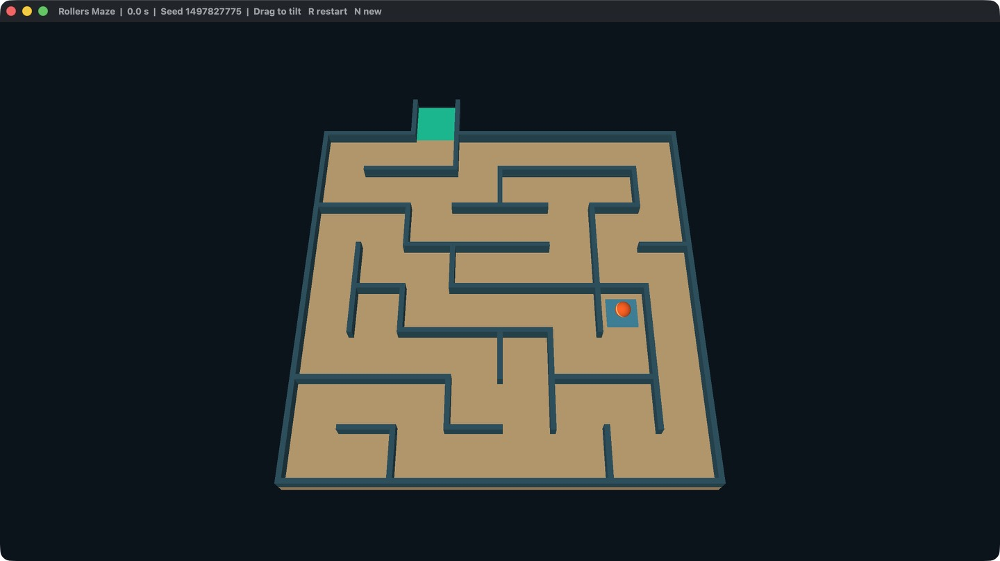

# Rollers Maze

Drag to lower one edge of the board and guide the striped marble onto the green landing. Each round has one route from the blue starting square to the exit. The seed in the title bar lets another player try the same layout.



## Play on macOS

With the Xcode Command Line Tools and Homebrew installed, the default configuration uses GLM for matrices, GLFW for input and window management, and GLEW to load OpenGL functions.

```sh
brew install cmake glfw glew glm
cmake -S . -B build -DCMAKE_BUILD_TYPE=Release -DROLLERS_APPLE_SIMD=OFF
cmake --build build --parallel
ctest --test-dir build --output-on-failure
./build/rollers --seed 42
```

Omit `--seed 42` for a random first board. The camera stays fixed. Hold the left mouse button and drag toward the edge you want to lower. A drag of roughly 105 window points reaches the 15° limit. Release to ease the board back to level. The timer starts on the first press and freezes when the marble clears the opening. Press **R** to restart the same maze or **N** to generate another.

## How it works

- **Generation.** Each of the 64 cells stores four wall bits. Randomized depth-first search uses an explicit stack and removes both bits of each carved edge. Breadth-first search then selects a farthest boundary cell and opens one outside edge. The generator emits each remaining edge once as a box. A 1.5-unit cell with 0.16-unit walls leaves room for the 0.48-unit marble to turn. See [maze.cpp](src/maze.cpp).
- **Tilt and motion.** Positions and velocities live on the board’s local XZ plane. The renderer places every object using `boardRotation * localTransform`. Physics uses the transpose of that same rotation to project world gravity onto the board. A fixed 120 Hz accumulator updates velocity before position, with damping, a speed limit, and a 100 ms frame-delta cap. See [physics.cpp](src/physics.cpp).
- **Contacts and exit.** The circle collides with the same rectangles that define the visible walls. The closest point supplies a contact normal. An embedded center uses the nearest face. The solver separates the marble, removes inward velocity, and repeats for simultaneous contacts. Each collision step travels at most half a wall thickness. Winning requires an outward crossing followed by a full radius of clearance on the landing.
- **Rendering.** A shared cube mesh draws the floor, walls, and pads. A latitude-longitude sphere carries a stripe that rotates by the distance actually traveled after contacts, divided by its radius. A fixed perspective camera looking down from 14° off vertical and directional light make raised edges visible. The viewport and projection both use framebuffer dimensions. See [renderer.cpp](src/renderer.cpp).

## Verification

Verified on Apple Silicon running macOS 26.6.2 with AppleClang 21, CMake 3.30.2, GLFW 3.4 and GLEW 2.2. GLM was unavailable on the test machine. The following clean Release build and CTest run used the Apple SDK’s SIMD implementation of the matrix operations.

```sh
cmake -S . -B build-release -DCMAKE_BUILD_TYPE=Release -DROLLERS_APPLE_SIMD=ON
cmake --build build-release --parallel
ctest --test-dir build-release --output-on-failure
./build-release/rollers --seed 42
```

The native game window rendered the screenshot above. The new-maze shortcut produced a different layout and seed, and the board retained its proportions after zooming the window. Headless tests checked 1,024 seeds for connectivity, shared edges, exit placement and replay. Four simulated playthroughs steered the marble from rest to the landing using legal tilts and the production collision solver. Additional cases cover level rest, downhill direction, render-rate consistency, wall slides, embedded centers, corners, fast impacts, and false wins.

Full mouse-driven playthroughs, the default GLM build, and other operating systems still need verification.
